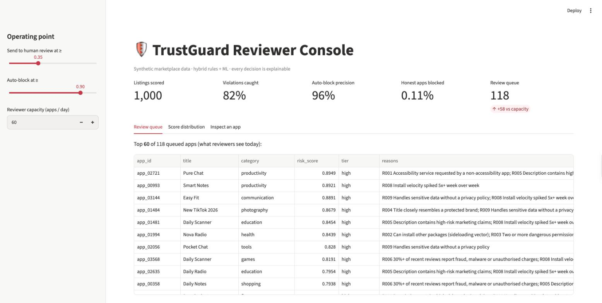
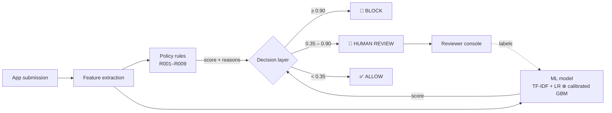
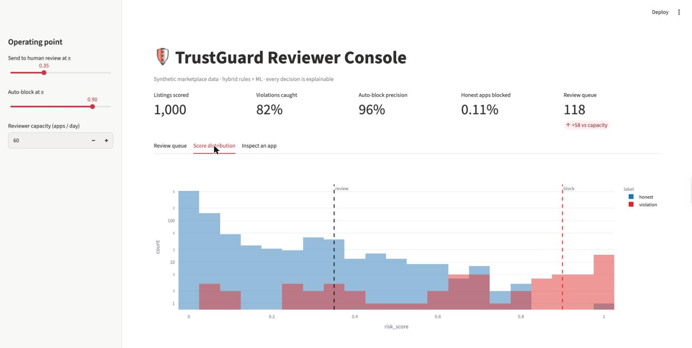
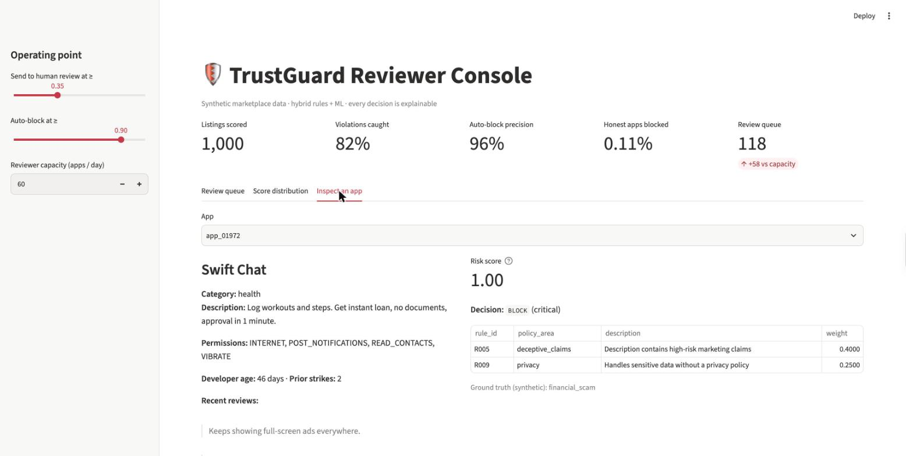

<div align="center">

# 🛡️ TrustGuard

**Policy-risk detection for app marketplaces: explainable rules + machine learning + human-review routing.**

[](https://github.com/ArunVijayNura/trustguard/actions/workflows/ci.yml)


[](https://trustguard.streamlit.app/)

**[▶ Try the live reviewer console](https://trustguard.streamlit.app/)**

</div>

---

App stores receive far more submissions than people can review by hand. Bad actors exploit
that gap with **malware droppers, financial scams, deceptive-ad schemes and brand look-alikes**.
TrustGuard scores every submission in milliseconds. It routes each one to `ALLOW`,
`HUMAN_REVIEW` or `BLOCK`, and gives a reason that both a reviewer and a developer can understand.

<p align="center"></p>

## Results

On held-out synthetic data (2,000 listings, 5.9% violation rate):

| System | PR-AUC | Recall @ 10% review capacity | False blocks on honest apps | Violations caught |
|---|:-:|:-:|:-:|:-:|
| Rules only | 0.38 | 51% | 0.0% | 66% |
| ML only | 0.66 | 75% | 0.0% | 70% |
| **Hybrid (TrustGuard)** | **0.67** | **75%** | **0.1%** | **80%** |

The hybrid catches **14 points more abuse than rules alone**. It wrongly blocks about **1 in 1,000**
honest apps. Full report: [`reports/evaluation.md`](reports/evaluation.md).

> **About the data:** real store data isn't public. A generator ([`data.py`](src/trustguard/data.py))
> produces listings where signals *overlap*. Violators show any given risk signal only part of the time,
> and some honest apps show risky signals too. That is why the numbers are realistic rather than perfect.

## How it works



| Layer | What it does |
|---|---|
| **Features** | 12 signals: permissions not justified by the category, developer age and strikes, install-velocity spikes, review complaint rate, look-alike brand titles (fuzzy match catches `Wh4tsApp`), risky marketing claims, missing privacy policy |
| **Rules** | 9 policy rules the policy team can read and own. Combined with noisy-OR, so independent weak signals add up |
| **Model** | Logistic regression on TF-IDF text + scaled features, blended with an isotonic-calibrated gradient-boosted model |
| **Decision** | `risk = 1 − (1 − model) × (1 − 0.6 × rules)`. Two thresholds: *block* tuned for precision, *review* tuned to reviewer capacity |
| **Fallback** | If the model is unavailable, the service runs on rules only. It never fails open |

Design reasoning: [`docs/ARCHITECTURE.md`](docs/ARCHITECTURE.md) · Product spec and metrics: [`docs/PRD.md`](docs/PRD.md)

## Quickstart

```bash
git clone https://github.com/ArunVijayNura/trustguard.git && cd trustguard
python -m venv .venv && source .venv/bin/activate
make install          # pip install -e ".[dev,dashboard]"
make test             # 14 tests
make evaluate         # comparison table + reports/evaluation.md
make dashboard        # reviewer console at http://localhost:8501
make api              # REST API at http://localhost:8000/docs
```

Or with Docker:

```bash
docker build -t trustguard . && docker run -p 8000:8000 trustguard
```

## API

```bash
curl -s localhost:8000/v1/score -H 'content-type: application/json' -d @- <<'EOF'
{"app_id":"demo","title":"Wh4tsApp Plus","category":"communication",
 "description":"The original app you trust, faster.",
 "permissions":["INTERNET","BIND_ACCESSIBILITY_SERVICE","REQUEST_INSTALL_PACKAGES"],
 "developer_account_age_days":9,"developer_prior_strikes":1,
 "installs_prev_7d":200,"installs_7d":4100,"avg_rating":2.1,
 "reviews":["Fake app, stole my login."],"has_privacy_policy":false}
EOF
```

```json
{
  "app_id": "demo",
  "risk_score": 1.0,
  "action": "BLOCK",
  "tier": "critical",
  "reasons": [
    {"rule_id": "R001", "policy_area": "malware", "description": "Accessibility service requested by a non-accessibility app", "weight": 0.55},
    {"rule_id": "R004", "policy_area": "impersonation", "description": "Title closely resembles a protected brand", "weight": 0.5}
  ],
  "latency_ms": 19.4,
  "model_version": "1.0.0"
}
```

Measured locally: p50 **19 ms**, p95 **24 ms** per request (200 requests, laptop CPU).

CLI: `trustguard score examples/listings.json`

## Reviewer console

| Tune the operating point | Explain any decision |
|---|---|
|  |  |

Policy leads move the sliders and see the trade-off right away: violations caught, auto-block
precision, honest apps blocked, and queue size compared with reviewer capacity.

## Project structure

```
src/trustguard/
  data.py        synthetic marketplace generator
  features.py    signal engineering
  rules.py       explainable policy rules
  model.py       training, blending, persistence
  scoring.py     decision layer + thresholds
  evaluate.py    T&S metrics (recall @ capacity, false-block rate)
  api.py         FastAPI service
  cli.py         trustguard train | evaluate | score
dashboard/app.py reviewer console (Streamlit)
tests/           unit + API tests (run in CI on 3.10–3.12)
docs/            PRD, architecture, screenshots
```

## Roadmap

- [ ] Ad-SDK signals to improve deceptive-ads recall (currently the weakest category at 61%)
- [ ] Active learning: send the most informative borderline apps to reviewers
- [ ] Developer-graph features (shared signing keys or payment instruments)
- [ ] Shadow-mode testing for threshold changes
- [ ] Drift monitoring and a weekly retraining job

## License

MIT
