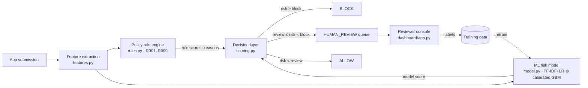

# Architecture

## Design decisions

**Why hybrid instead of model-only?**
Rules give day-one coverage, catch known-bad patterns even when the model has
not seen them, and give a readable reason for every decision. The model finds
combinations of weak signals that no single rule captures. Combining them with
noisy-OR means neither can *hide* the other's signal.

**Why two thresholds?**
Auto-blocking and human review have very different costs. The block threshold
is tuned for precision (a wrong takedown hurts an honest developer). The review
threshold is tuned to reviewer capacity, so the queue matches staffing.

**Why calibrate the GBM?**
Thresholds only mean something if scores are probabilities. Isotonic
calibration keeps a score of 0.9 close to "90% likely to be a violation", which
lets policy leads reason about thresholds directly.

**Graceful degradation.**
If the model artifact is missing or fails to load, `decide(listing, None)`
falls back to rules only, so the service never fails open.

## Module map

| Module | Responsibility |
|---|---|
| `data.py` | Synthetic marketplace generator with overlapping signal distributions |
| `features.py` | 12 engineered signals + combined text field |
| `rules.py` | Declarative policy rules, noisy-OR aggregation |
| `model.py` | Training, blending, persistence |
| `scoring.py` | Decision layer, thresholds, batch scoring |
| `evaluate.py` | T&S metrics: recall at capacity, false-block rate, per-type recall |
| `api.py` | FastAPI service (`/v1/score`, `/v1/score/batch`, `/health`) |
| `cli.py` | `trustguard train / evaluate / score` |
